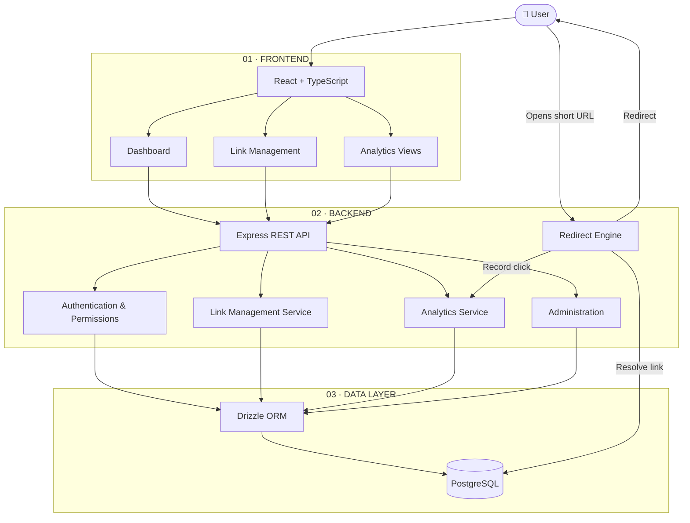
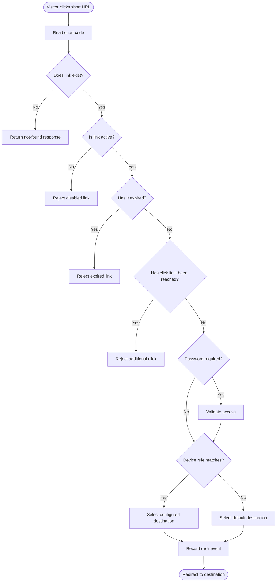
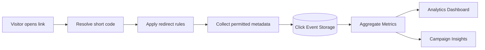
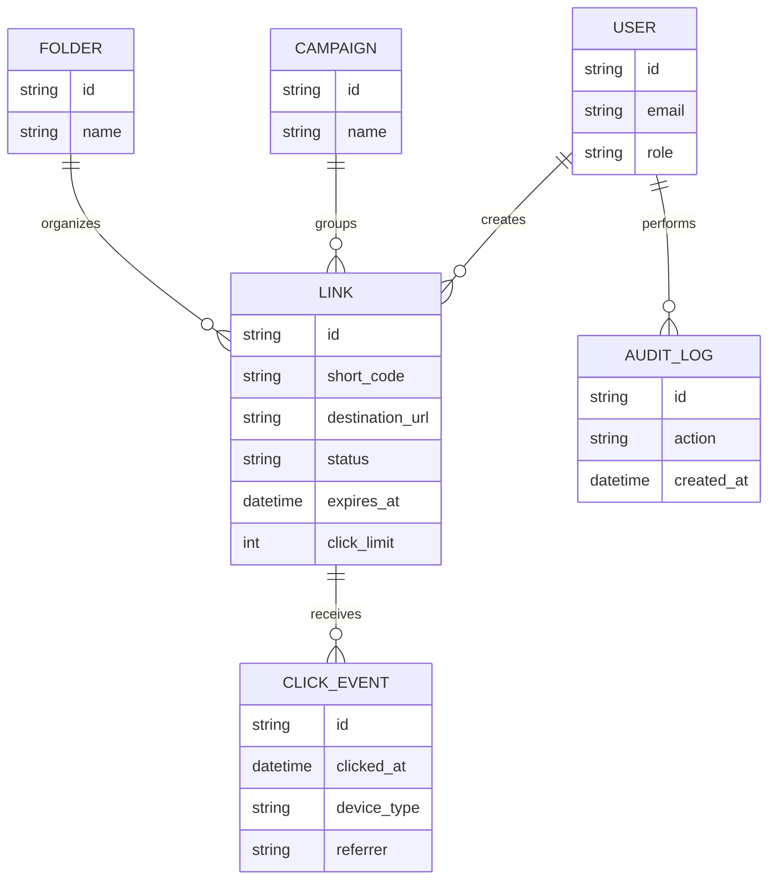
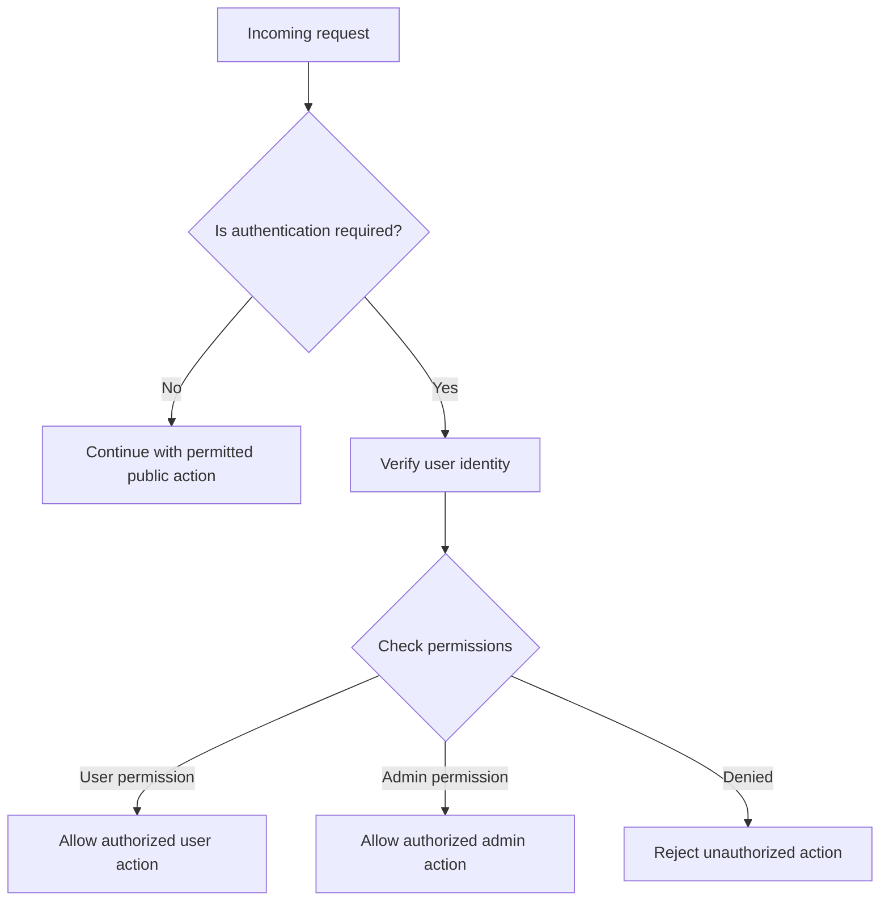
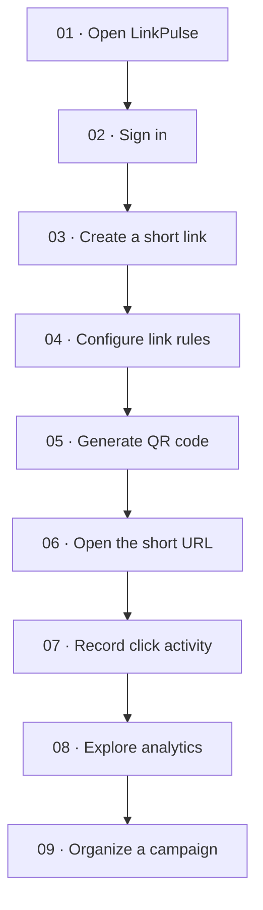

<div align="center">

# ⚡ LinkPulse

### Engineering Every Link. Measuring Every Click.

**A modern URL shortening and analytics platform.**

Create short links. Configure redirects. Organize campaigns. Understand clicks.

<br/>

<a href="https://linkpulse2026.vercel.app/">
  
</a>
<a href="https://github.com/SurajRawatr07/LinkPulse">
  
</a>

<br/><br/>


<br/>

**One link. More control. Better insights.**

</div>

---

## 📍 Table of Contents

- [Overview](#-overview)
- [The Problem](#-the-problem)
- [Key Features](#-key-features)
- [What Makes LinkPulse Different](#-what-makes-linkpulse-different)
- [Screenshots and Preview](#-screenshots--live-preview)
- [System Architecture](#-system-architecture)
- [How LinkPulse Works](#-how-linkpulse-works)
- [Click Analytics Workflow](#-click-analytics-workflow)
- [Technology Stack](#-technology-stack--what-each-tool-does)
- [Database Schema](#-database-schema--data-model)
- [API Reference](#-api-reference)
- [Security and Access Control](#-security--access-control)
- [Project Structure](#-project-structure)
- [Getting Started](#-getting-started)
- [Demo Workflow](#-demo-workflow-for-judges)
- [Testing](#-testing)
- [Roadmap](#-roadmap)
- [Contributing](#-contributing)
- [Security Policy](#-security-policy)
- [License](#-license)
- [Author](#-author)

---

## 📌 Overview

**LinkPulse** is a URL shortening and link analytics platform that
helps users create, manage, share, and measure links from one workspace.

A traditional URL shortener makes a long URL smaller. LinkPulse aims
to make that link manageable throughout its lifecycle.

Users can create short URLs, configure redirect behaviour, organize
links into campaigns, generate QR codes, and explore click activity.

### The LinkPulse workflow

<div align="center">

**CREATE** → **CONFIGURE** → **SHARE** → **TRACK** → **ANALYZE**

</div>

Each stage has a clear purpose: create the link, define its rules,
share it with an audience, record interactions, and understand results.

---

## 🎯 The Problem

Managing links becomes difficult when campaigns, audiences, and
destinations grow.

| Common problem | LinkPulse approach |
|---|---|
| Long URLs are inconvenient to share | Create shorter, shareable links |
| Links become difficult to organize | Group links into campaigns and folders |
| A destination needs access or expiry rules | Configure supported redirect controls |
| Basic click counts provide limited context | Explore available click analytics |
| Many links must be created together | Use CSV bulk-import workflows |
| Links need to be shared offline | Generate QR codes |

### Our goal

Make link management more than a copy-and-paste operation.

---

## ✨ Key Features

<table>
<tr>
<td width="50%" valign="top">

### 🔗 Smart Link Management

- Short URL creation
- Custom aliases
- Expiration settings
- Click-limit controls
- Password-protected links
- Device-based redirect rules

</td>
<td width="50%" valign="top">

### 📊 Click Analytics

- Click activity over time
- Device breakdown
- Browser and operating-system insights
- Referrer information
- Campaign-level reporting
- Privacy-conscious analytics design

</td>
</tr>
<tr>
<td width="50%" valign="top">

### 🗂️ Campaign Workspace

- Campaign organization
- Folders and tags
- Centralized link management
- Related-link grouping
- Easier discovery and maintenance

</td>
<td width="50%" valign="top">

### ⚡ Productivity & Administration

- QR code generation
- CSV bulk import
- Link moderation
- Domain blocklist
- Abuse-management workflows
- Administrative audit records

</td>
</tr>
</table>

> Documentation should reflect the working application. Verify every
> feature against the submitted build before claiming it is implemented.

---

## 🚀 What Makes LinkPulse Different?

LinkPulse brings link creation, redirect controls, organization,
and click analytics into a unified workflow.

| Capability | Basic shortener | LinkPulse approach |
|---|---|---|
| Short links | Core functionality | Core functionality |
| Custom aliases | Depends on provider | Configurable aliases |
| Link lifecycle | Often limited | Expiry and usage controls |
| Password protection | Varies | Protected-link workflow |
| Device-based redirects | Less common | Configurable routing |
| QR codes | Sometimes separate | Integrated workflow |
| Bulk link creation | Varies | CSV import workflow |
| Campaign organization | Often limited | Campaigns, folders, and tags |
| Traffic insights | Often basic | Multiple analytics dimensions |
| Moderation | Varies | Administrative controls |

### 💡 The key differentiator

**A LinkPulse link is intended to be more than a shortened URL.**

It can have a destination, redirect rules, an organizational context,
and associated click activity.

This makes the platform useful for campaigns, events, portfolios,
student projects, product launches, and shared resources.

---

## 🖥️ Screenshots & Live Preview

<div align="center">

### Explore the actual application

<a href="https://linkpulse2026.vercel.app/">
  
</a>

</div>

### Product screenshots

Add screenshots captured from the actual website to the repository.
These images help judges understand the product before reading the
technical documentation.

<div align="center">

| Dashboard | Link Management |
|---|---|
|  |  |
| *Main workspace* | *Create and manage links* |

| Analytics | Campaigns |
|---|---|
|  |  |
| *Traffic insights* | *Organize related links* |

</div>

**Screenshot setup**

1. Open the [live LinkPulse website](https://linkpulse2026.vercel.app/).
2. Navigate to each page that is available and working.
3. Capture genuine screenshots without private information.
4. Save the images under `docs/screenshots/`.
5. Use the exact filenames referenced above, or update the Markdown paths.

```text
docs/
└── screenshots/
    ├── dashboard.png
    ├── links.png
    ├── analytics.png
    └── campaigns.png
```

> The image paths above are placeholders until you add the actual
> screenshots. Do not leave broken image references in the final README.

---

## 🏗️ System Architecture

This diagram explains how the main application components communicate.



### How to read this diagram

| Layer | Responsibility |
|---|---|
| Frontend | Displays the dashboard, forms, links, and analytics charts |
| REST API | Receives application requests and routes them to backend services |
| Authentication | Verifies identity and permissions for protected actions |
| Link service | Creates and updates link records and settings |
| Redirect engine | Resolves short codes and applies configured redirect rules |
| Analytics service | Records or processes click-related data |
| ORM | Connects application code to database queries |
| PostgreSQL | Stores persistent application records |

**In simple words:** The frontend is what the user sees. The backend
contains the application logic. The database stores the information.

---

## 🔄 How LinkPulse Works

When someone opens a short URL, the application must resolve the code,
check the applicable rules, and determine the next action.



### Redirect process, step by step

1. The visitor opens a short URL.
2. The server extracts its unique short code.
3. The application looks up the associated link.
4. Applicable status, expiration, and click-limit rules are checked.
5. Password access is validated when required.
6. A matching device rule can select a configured destination.
7. The application records permitted click information.
8. The visitor is redirected to the selected destination.

The exact validation order and response behaviour should match the
implementation. For example, a password-protected link may require an
access step before a final redirect.

---

## 📈 Click Analytics Workflow

Click analytics help turn link activity into information users can
understand and act on.



### What can users learn?

| Analytics dimension | Question it helps answer |
|---|---|
| Click trends | When did traffic increase or decrease? |
| Device category | Which device types generated clicks? |
| Browser and OS | What browser and operating-system distribution was observed? |
| Referrers | Which sources sent visitors? |
| Campaign metrics | How did grouped links perform over time? |

Analytics depend on the metadata actually captured by the application.
Geographic insights should be shown only when supported by the data,
and estimated location must not be presented as exact location.

---

## 🧩 Technology Stack & What Each Tool Does

### 🎨 Frontend

| Technology | Purpose |
|---|---|
| React | Builds reusable components and interface pages |
| TypeScript | Adds static types and improves maintainability |
| Vite | Runs the development server and builds frontend assets |
| Tailwind CSS | Creates responsive layouts and consistent styling |
| React Router | Handles navigation between pages |
| Zustand | Manages shared client-side state |
| Recharts | Renders charts for analytics |
| Zod | Validates data against defined schemas |
| Lucide React | Supplies interface icons |
| qrcode.react | Renders QR codes |
| Papa Parse | Parses CSV data for bulk-import workflows |

### ⚙️ Backend

| Technology | Purpose |
|---|---|
| Node.js | Runs server-side JavaScript |
| Express | Handles HTTP requests, routes, and middleware |
| REST API | Defines communication between the frontend and backend |
| Firebase Auth | Supports configured sign-in workflows |
| Firebase Admin SDK | Supports trusted server-side authentication checks |
| bcryptjs | Hashes passwords for safer storage |
| ua-parser-js | Parses user-agent information for device analytics |

### 🗄️ Database & Infrastructure

| Technology | Purpose |
|---|---|
| PostgreSQL | Stores persistent relational data |
| Google Cloud SQL | Provides managed PostgreSQL hosting when configured |
| Drizzle ORM | Provides typed database query operations |
| Drizzle Kit | Supports database schema and migration workflows |
| Secure session cookies | Carry session information with appropriate cookie controls |
| Vercel | Hosts the frontend and supported deployment components |

> Verify these dependencies against `package.json`, the server code,
> and the deployment configuration. Listing a technology does not
> establish that its service is currently configured in production.

---

## 🗃️ Database Schema & Data Model

The conceptual model below illustrates how the primary records relate.



### Main entities

- **User:** Account identity and role.
- **Link:** Short code, destination, status, and configured rules.
- **Campaign:** Groups links related to a common activity.
- **Folder:** Organizes links for easier management.
- **Click event:** Represents a recorded interaction with a link.
- **Audit log:** Records relevant administrative activity.

This diagram is conceptual. Keep it aligned with the real schema and
database migrations in the repository.

---

## 🔌 API Reference

The application uses a versioned API structure.

**Base path:** `/api/v1`

| API area | Purpose |
|---|---|
| Authentication | Identity and session-related operations |
| Links | Create, retrieve, update, and manage links |
| Redirects | Resolve short codes and evaluate redirect rules |
| Analytics | Retrieve click metrics and summaries |
| Campaigns | Organize and retrieve campaign information |
| Administration | Manage moderation and administrative operations |
| Health | Check service availability |

### Illustrative endpoint structure

```http
GET    /api/v1/health
GET    /api/v1/links
POST   /api/v1/links
GET    /api/v1/links/:id
PATCH  /api/v1/links/:id
DELETE /api/v1/links/:id
GET    /api/v1/analytics
GET    /api/v1/campaigns
POST   /api/v1/campaigns
GET    /r/:code
```

These paths are examples of an API layout, not a verified list of
implemented endpoints. Confirm each route against the server source.

---

## 🛡️ Security & Access Control

LinkPulse needs appropriate access controls to protect link settings,
user data, and administrative actions.



### Security principles

- Validate input before processing requests.
- Enforce permissions on the server.
- Hash passwords rather than storing plaintext passwords.
- Keep credentials and private keys out of source control.
- Apply link expiration and click limits consistently.
- Protect private link operations with appropriate checks.
- Maintain audit records for relevant administrative operations.
- Minimize sensitive data in analytics.

Only describe controls as implemented after verifying their actual
server-side enforcement.

---

## 📂 Project Structure

An illustrative full-stack project layout:

```text
LinkPulse/
├── public/
├── src/
│   ├── components/
│   ├── pages/
│   ├── hooks/
│   ├── lib/
│   ├── store/
│   ├── types/
│   └── main.tsx
├── server/
│   ├── routes/
│   ├── services/
│   ├── middleware/
│   └── db/
├── docs/
│   └── screenshots/
├── .env.example
├── package.json
├── README.md
└── vite.config.ts
```

This is a reference layout. Replace it with the actual directory tree
so developers can navigate the repository accurately.

---

## ⚙️ Getting Started

### Prerequisites

- Node.js compatible with the project
- pnpm or the package manager used by the repository
- PostgreSQL, if required by the configured backend
- Firebase credentials, if Firebase authentication is enabled
- Required environment variables

### Installation

```bash
git clone https://github.com/SurajRawatr07/LinkPulse.git
cd LinkPulse
pnpm install
```

### Environment Variables

Create the environment files required by the source code.

Example placeholders:

```env
DATABASE_URL=
FIREBASE_PROJECT_ID=
FIREBASE_CLIENT_EMAIL=
FIREBASE_PRIVATE_KEY=
SESSION_SECRET=
```

Use the exact variable names referenced in the implementation.

**Never commit real credentials, database passwords, or private keys.**

### Running Locally

First, inspect the scripts available in `package.json`:

```bash
pnpm run
```

Run the frontend and backend using the actual scripts defined by the
project. Configure database access, authentication, and migrations
where required.

---

## 🎯 Demo Workflow for Judges

Use this flow to explain LinkPulse during a project presentation.



### What the judge should understand

1. **Problem:** Ordinary URLs are difficult to organize and measure.
2. **Solution:** LinkPulse manages links in a unified workspace.
3. **Architecture:** The frontend, backend, redirect engine, and database have distinct responsibilities.
4. **Differentiator:** Configurable redirect behaviour goes beyond basic shortening.
5. **Analytics:** Click activity can feed reporting and campaign insights.
6. **Trust:** Access controls and moderation support responsible link management.

Demonstrate only features that are functional in the submitted build.

---

## 🧪 Testing

Use this checklist before the demo.

- [ ] Create a short link.
- [ ] Open the short URL and verify the destination.
- [ ] Test custom aliases.
- [ ] Verify expiration behaviour.
- [ ] Verify click-limit behaviour.
- [ ] Test password-protected links.
- [ ] Test device-based routing.
- [ ] Verify click events and analytics.
- [ ] Test missing or invalid short codes.
- [ ] Check unauthorized administrative requests.
- [ ] Check the interface on mobile and desktop.

Run the tests configured in the repository. Do not claim that tests
pass until they have actually been executed.

---

## 🛣️ Roadmap

Potential future improvements:

- [ ] Export analytics reports.
- [ ] Compare campaigns side by side.
- [ ] Detect unusual click patterns.
- [ ] Monitor broken destination URLs.
- [ ] Schedule link activation and deactivation.
- [ ] Add API-key management and developer documentation.
- [ ] Add configurable analytics-retention controls.
- [ ] Expand automated redirect-rule testing.

These items are proposed enhancements, not claims about existing features.

---

## 🤝 Contributing

Contributions can improve reliability, usability, testing, and
documentation.

1. Fork the repository.
2. Create a feature branch.
3. Make a focused change.
4. Run relevant checks and tests.
5. Submit a pull request with a clear description.

Discuss substantial changes in an issue before implementation.

---

## 🔒 Security Policy

Never publish credentials, access tokens, private keys, or database
passwords in issues or pull requests.

Report vulnerabilities through a private reporting channel if one is
available for this repository.

---

## 📄 License

Add the license that actually applies to this repository. If no license
has been selected, do not claim that the project uses a particular
open-source license.

---

## 👨‍💻 Author

<div align="center">

### Suraj Rawat

Full-Stack Developer · LinkPulse

[GitHub](https://github.com/SurajRawatr07) ·
[LinkedIn](https://www.linkedin.com/in/suraj-rawat-30513b340/) ·
[Live Project](https://linkpulse2026.vercel.app/)

</div>

---

<div align="center">

### ⚡ LinkPulse

**Create smarter links. Understand every click.**

[Explore the Live Demo](https://linkpulse2026.vercel.app/) ·
[View Source Code](https://github.com/SurajRawatr07/LinkPulse)

</div>
