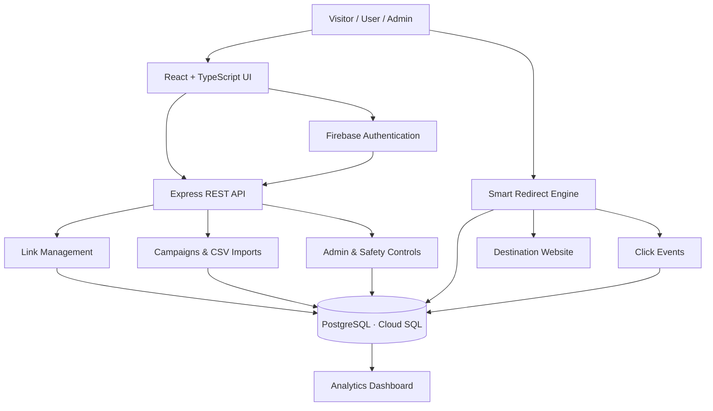
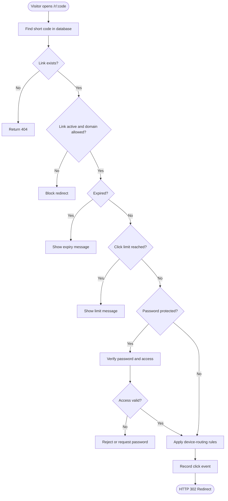

# LinkPulse — Full-Stack URL Shortener & Analytics Platform

**Short Links. Smart Insights. Enterprise-Grade Safety.**

LinkPulse is a full-stack URL management platform that transforms ordinary URLs into trackable, configurable, and security-aware digital assets. It combines link shortening, smart redirects, click analytics, QR codes, campaign management, bulk imports, and administrative controls in one responsive application.

🌐 **Live Demo:** https://linkpulse2026.vercel.app/  
💻 **GitHub Repository:** https://github.com/SurajRawatr07/LinkPulse

---

## ✨ What Makes LinkPulse Different?

Unlike a basic URL shortener, LinkPulse is designed to manage the complete lifecycle of a short link.

- **Smart Redirect Engine:** Validates link status, safety, expiration, click limits, passwords, and device-routing rules.
- **Click Intelligence:** Organizes click events into analytics covering traffic trends, devices, browsers, operating systems, and referrers.
- **Campaign Management:** Groups links using campaigns, folders, and tags.
- **QR & Bulk Studio:** Generates QR codes and supports CSV-based link imports with validation.
- **Trust & Safety:** Provides domain blocklisting, suspicious-link reporting, and administrative moderation.
- **Role-Based Access:** Separates visitor, user, and administrator permissions.
- **Responsive Experience:** Uses a dark slate interface, teal accents, and layouts designed for mobile and desktop.

## 🛠️ Tech Stack & What Each Technology Does

### Frontend

| Technology | Purpose in LinkPulse |
|---|---|
| React 18 | Builds reusable UI components, pages, forms, and dashboards. |
| TypeScript | Adds static type checking to components, data models, and application logic. |
| Vite | Runs the development server and bundles the frontend for production. |
| Tailwind CSS | Provides responsive styling, consistent design tokens, and dark-mode utilities. |
| React Router v6 | Handles navigation between public pages, authentication pages, user dashboards, and admin routes. |
| Zustand | Manages shared client-side state such as authentication status, themes, and notifications. |
| Recharts | Visualizes click trends, device distribution, referrers, and other analytics. |
| Zod | Validates user inputs and structured data, including URLs, aliases, forms, and CSV rows. |
| Lucide React | Supplies consistent icons for navigation, link controls, analytics, and actions. |
| qrcode.react | Renders QR codes for short links. |
| PapaParse | Parses CSV files for bulk-link import workflows. |

### Backend

| Technology | Purpose in LinkPulse |
|---|---|
| Node.js | Provides the JavaScript runtime for server-side execution. |
| Express.js | Defines API routes, middleware, authentication flows, and redirect handling. |
| TypeScript | Adds types to backend logic, API contracts, and database interactions. |
| REST API | Exposes endpoints for authentication, links, campaigns, analytics, imports, and administration. |
| Firebase Authentication | Supports user authentication, including configured email/password and Google sign-in flows. |
| Firebase Admin SDK | Verifies Firebase ID tokens and supports trusted server-side authentication operations. |
| bcryptjs | Hashes passwords and verifies password-protected links or local credentials, according to the implemented flows. |
| ua-parser-js | Parses user-agent strings to identify device categories, browsers, and operating systems. |

### Database & ORM

| Technology | Purpose in LinkPulse |
|---|---|
| PostgreSQL | Stores relational records such as users, links, campaigns, and click events. |
| Google Cloud SQL | Provides managed PostgreSQL database hosting when correctly configured and connected. |
| Drizzle ORM | Provides type-safe database queries and schema definitions. |
| Drizzle Kit | Supports database schema management and migration workflows. |

---

## 🏗️ System Architecture

This diagram shows how the main components connect.



### How the Architecture Works

1. **Frontend:** Users interact with the React application to create links, manage campaigns, and inspect analytics.
2. **Authentication:** Configured authentication flows establish the user's identity.
3. **API:** Express handles requests, validates input, and enforces server-side permissions.
4. **Database:** PostgreSQL stores application records and click-event data.
5. **Redirect engine:** Incoming short URLs are checked against configured rules before redirecting.
6. **Analytics:** Recorded click events supply the data used by the dashboard.
7. **Administration:** Authorized admins manage links, review reports, and maintain safety controls.

---

## 🔄 Smart Redirect Engine — Step-by-Step

Every public short link passes through a defined validation workflow before redirection.



**Redirect controls:**
- Link existence and activation status.
- Domain safety policy.
- Scheduled expiration.
- Click quota.
- Password verification where required.
- Device-specific destination selection.
- Click-event recording and redirection.

Click quotas should be enforced atomically on the server to prevent concurrent requests from exceeding the configured limit. The exact order and behavior must match the implementation.

---

## 📊 Analytics & Click Intelligence

LinkPulse is designed to turn redirect activity into useful performance insights.

- **Click Trends:** Observe changes in link engagement over time.
- **Device Distribution:** Compare mobile, desktop, and tablet traffic.
- **Browser & OS Attribution:** Understand the software visitors use.
- **Referrer Analysis:** Identify sources that send traffic.
- **Campaign Performance:** Group and compare related links.
- **Link-Level Analytics:** Inspect performance for individual short URLs.

Click events may include timestamps, device information, browser and OS details, referrer data, and anonymized IP hashes, according to the configured tracking implementation.

---

## 🔐 Authentication & Roles

| Role | Access |
|---|---|
| Visitor | Open public short links, complete password challenges, and submit public reports. |
| User | Manage owned links, aliases, campaigns, folders, tags, QR codes, and permitted analytics. |
| Admin | Manage platform links and users, moderate suspicious destinations, review abuse reports, and maintain the domain blocklist. |

Protected API operations must verify permissions on the server. Hiding a page in the frontend alone is not sufficient authorization.

---

## 🛡️ Trust & Safety

LinkPulse includes administrative safety capabilities intended to help manage suspicious links and enforce platform policies.

- Domain safety blocklist.
- Link activation and deactivation controls.
- Public malicious-link reporting.
- Password-protected links.
- Expiration and click-limit enforcement.
- Administrative moderation and audit logs.
- Server-side authentication and role checks.

**Security note:** A domain blocklist is a policy control, not a complete phishing-detection system. Reputation scoring and automated risk detection are potential future enhancements unless separately implemented.

---

## 📡 REST API Overview

Base API path: `/api/v1`

| Method | Endpoint | Purpose |
|---|---|---|
| GET | `/api/health` | Service and database health check |
| POST | `/api/v1/auth/register` | Register a user |
| POST | `/api/v1/auth/login` | Authenticate with email and password |
| POST | `/api/v1/auth/google-session` | Exchange a Firebase ID token |
| POST | `/api/v1/auth/demo-login` | Demo authentication |
| GET | `/api/v1/auth/me` | Retrieve the current user |
| POST | `/api/v1/auth/logout` | End the session |
| GET | `/api/v1/links` | List owned links |
| POST | `/api/v1/links` | Create a short link |
| POST | `/api/v1/links/check-alias` | Check custom alias availability |
| GET | `/api/v1/links/:id` | Retrieve link details |
| PATCH | `/api/v1/links/:id` | Update link configuration |
| DELETE | `/api/v1/links/:id` | Archive a link |
| POST | `/api/v1/links/:id/disable` | Disable a link |
| POST | `/api/v1/links/:id/enable` | Reactivate a link |
| GET | `/api/v1/links/:id/analytics` | Retrieve link analytics |
| GET | `/api/v1/campaigns` | List campaigns |
| POST | `/api/v1/campaigns` | Create a campaign |
| GET | `/api/v1/analytics/overview` | Retrieve analytics overview |
| POST | `/api/v1/imports/csv` | Import links from CSV |
| GET | `/api/v1/admin/overview` | Retrieve admin metrics |
| GET | `/api/v1/admin/users` | List users |
| GET | `/api/v1/admin/links` | List links for moderation |
| GET | `/api/v1/admin/blocklist` | Retrieve blocked domains |
| POST | `/api/v1/admin/blocklist` | Add a blocked domain |
| DELETE | `/api/v1/admin/blocklist/:id` | Remove a blocked domain |
| POST | `/api/v1/reports` | Submit an abuse report |
| GET | `/r/:code` | Resolve a public short URL |

---

## 🚀 Getting Started

### Prerequisites

- Node.js and npm
- Access to a configured PostgreSQL database
- Firebase configuration if required by the selected authentication flows
- Environment variables required by the backend

### Installation

```bash
git clone https://github.com/SurajRawatr07/LinkPulse.git
cd LinkPulse
npm install
```

### Environment Setup

Configure the required environment variables using `.env.example`, if available.

Never commit production credentials, private keys, or real database passwords to version control.

### Database Setup

Run the migration or schema setup commands configured in the repository. Verify the target database before applying migrations or seeding records.

If the seed script exists and is correctly configured:

```bash
npx tsx server/seed.ts
```

### Development

```bash
npm run dev
```

### Production Build

```bash
npm run build
npm run start
```

Check `package.json` for the exact available scripts and ensure the required services are configured before running the application.

---

## 🎬 Hackathon Demo Flow

### Scenario 1 — Create a Link and Inspect Analytics

1. Sign in using an authorized demo account.
2. Open the Create Link page.
3. Enter a destination URL and custom alias.
4. Publish the short link.
5. Generate and copy the QR code.
6. Open the short URL in a new tab.
7. Return to the dashboard and inspect the recorded click event.

### Scenario 2 — CSV Import and Admin Moderation

1. Open Bulk Import.
2. Upload a CSV containing valid and invalid entries.
3. Review row-level validation results.
4. Import valid links.
5. Sign in using an authorized admin account.
6. Disable a test link.
7. Open the short URL and verify that the redirect is blocked.
8. Test the domain blocklist with a controlled test domain.

Use controlled demo data and verify all scenarios in the actual deployed environment before presenting them.

---

## 💡 Potential Future Enhancements

These are proposed improvements, not claims of existing functionality.

- **Link Risk Intelligence:** Add domain reputation checks and explainable risk indicators.
- **Click Anomaly Detection:** Alert on unusual traffic spikes and suspicious patterns.
- **Campaign Comparison:** Compare campaign performance across date ranges and export reports.
- **Link Lifecycle Timeline:** Record and display creation, updates, disabling, reactivation, and expiration events.
- **Workspace Collaboration:** Introduce shared workspaces and permission-based team access.

---

## 👨‍💻 Project Links

- **Live Website:** https://linkpulse2026.vercel.app/
- **GitHub Repository:** https://github.com/SurajRawatr07/LinkPulse

---

**LinkPulse — Every link has a lifecycle. Every click has a story.**
