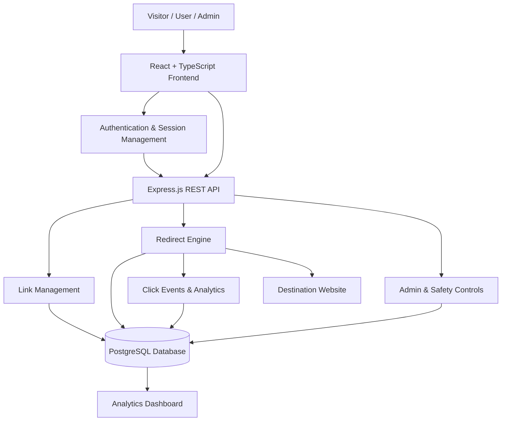
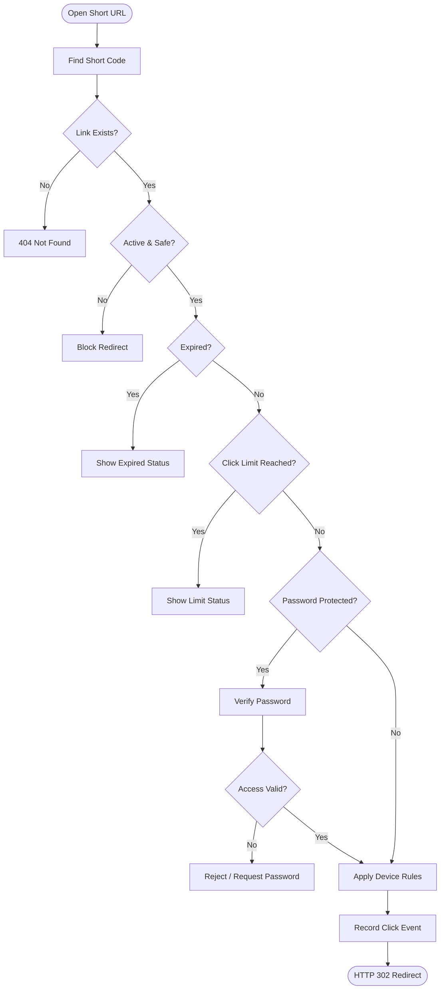

# LinkPulse — URL Shortener & Analytics Platform

**Short Links. Smart Insights. Enterprise-Grade Safety.**

A full-stack URL shortening and analytics platform built with React, TypeScript, Express.js, PostgreSQL, and Drizzle ORM.

🌐 **Live Demo:** https://linkpulse2026.vercel.app/  
💻 **GitHub:** https://github.com/SurajRawatr07/LinkPulse

## ✨ Features

- **Smart URL Shortening:** Custom aliases, expiration dates, click limits, and password-protected links.
- **Advanced Analytics:** Click trends, device distribution, browser details, operating systems, and referrer tracking.
- **Campaign Management:** Organize links with campaigns, folders, and tags.
- **QR Code Generation:** Generate QR codes for easy link sharing.
- **Bulk CSV Import:** Import multiple links with validation and duplicate detection.
- **Smart Redirects:** Device-based routing, link status checks, expiry validation, and click-limit enforcement.
- **Authentication:** Email/password login, Google Sign-In, and session management.
- **Role-Based Access Control:** Separate permissions for visitors, users, and administrators.
- **Admin Dashboard:** Manage users, moderate links, maintain domain blocklists, and review abuse reports.
- **Security Controls:** Password hashing, server-side authorization, and anonymized click attribution.
- **Responsive UI:** Dark slate design with teal accents and layouts for mobile, tablet, and desktop.

## 🛠️ Tech Stack

### Frontend
- React 18
- TypeScript
- Vite
- Tailwind CSS
- React Router v6
- Zustand
- Recharts
- Zod
- Lucide React
- qrcode.react
- PapaParse

### Backend
- Node.js
- Express.js
- TypeScript
- REST API
- Firebase Authentication
- Firebase Admin SDK
- bcryptjs
- ua-parser-js

### Database
- PostgreSQL
- Google Cloud SQL
- Drizzle ORM
- Drizzle Kit

## 🏗️ System Architecture



## 🔄 Redirect Workflow



## 🔐 User Roles

| Role | Permissions |
|---|---|
| Visitor | Open public links and report suspicious URLs |
| User | Manage links, QR codes, campaigns, and owned-link analytics |
| Admin | Manage users, moderate links, maintain blocklists, and review reports |

## 📡 API Reference

| Method | Endpoint | Description |
|---|---|---|
| GET | `/api/health` | Health check |
| POST | `/api/v1/auth/register` | Register |
| POST | `/api/v1/auth/login` | Login |
| POST | `/api/v1/auth/google-session` | Google authentication |
| POST | `/api/v1/auth/demo-login` | Demo login |
| GET | `/api/v1/auth/me` | Current user |
| POST | `/api/v1/auth/logout` | Logout |
| GET | `/api/v1/links` | List links |
| POST | `/api/v1/links` | Create link |
| POST | `/api/v1/links/check-alias` | Check alias |
| GET | `/api/v1/links/:id` | Link details |
| PATCH | `/api/v1/links/:id` | Update link |
| DELETE | `/api/v1/links/:id` | Archive link |
| GET | `/api/v1/links/:id/analytics` | Link analytics |
| GET | `/api/v1/campaigns` | List campaigns |
| POST | `/api/v1/campaigns` | Create campaign |
| GET | `/api/v1/analytics/overview` | Analytics overview |
| POST | `/api/v1/imports/csv` | CSV import |
| GET | `/api/v1/admin/overview` | Admin overview |
| GET | `/api/v1/admin/users` | Manage users |
| GET | `/api/v1/admin/links` | Moderate links |
| GET | `/api/v1/admin/blocklist` | View blocklist |
| POST | `/api/v1/admin/blocklist` | Add blocked domain |
| POST | `/api/v1/reports` | Report suspicious link |
| GET | `/r/:code` | Resolve short URL |

## 🚀 Getting Started

### Prerequisites
- Node.js
- npm
- PostgreSQL access
- Firebase configuration

### Installation

```bash
git clone https://github.com/SurajRawatr07/LinkPulse.git
cd LinkPulse
npm install
```

### Environment Variables

Configure the required variables using `.env.example`, if available. Never commit secrets or production credentials.

### Database Setup

Run the migration commands configured in the repository. If the seed script exists and targets the intended database:

```bash
npx tsx server/seed.ts
```

### Development

```bash
npm run dev
```

### Production Build

```bash
npm run build
npm run start
```

Check `package.json` for the available scripts before running commands.

## 🎬 Hackathon Demo

### Scenario 1: Link Creation & Analytics
1. Sign in with an authorized demo account.
2. Create a short link with a custom alias.
3. Generate and copy its QR code.
4. Open the short URL.
5. Return to the dashboard and inspect click analytics.

### Scenario 2: Bulk Import & Admin Moderation
1. Upload a CSV containing valid and invalid entries.
2. Review row-level validation results.
3. Import valid links.
4. Sign in as an authorized admin.
5. Disable a test link.
6. Verify that the disabled link no longer redirects.
7. Test domain blocking with a controlled test domain.

## 🔒 Security & Reliability

- Validate URLs and aliases server-side.
- Enforce user ownership and role permissions.
- Apply expiry and click-limit checks before redirecting.
- Use secure session-cookie settings.
- Hash passwords securely.
- Minimize collection of personally identifiable data.
- Keep secrets in environment variables.
- Test authentication, database connectivity, and redirect behavior before deployment.

## 🚀 Future Enhancements

- Link risk intelligence and domain reputation checks.
- Click anomaly detection and suspicious traffic alerts.
- Campaign comparison and analytics exports.
- Link lifecycle history and change tracking.
- Workspace collaboration.

---

**LinkPulse — Every link has a lifecycle. Every click has a story.**
